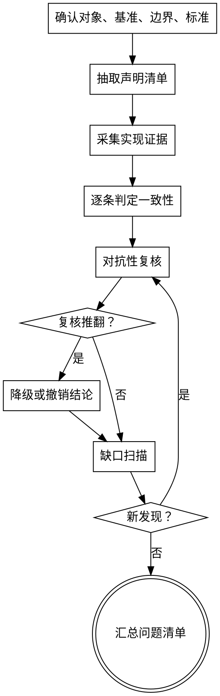

# 一致性审计与对抗性复核

把"文档说了什么"和"代码实际做了什么"逐条对齐，再让独立的复核者去推翻审计结论。两个阶段缺一不可：只做对照会漏掉审计者自己的判断偏差，只做复核没有可复核的基线。

**开始时声明：** “我正在使用 audit-and-grill 技能执行一致性审计与对抗性复核。”

## 适用与不适用

适用：

- 实现计划勾选已完成，但实际代码缺少对应行为
- 设计文档、ADR、README、接口文档与代码行为不一致
- 迁移、重构完成后旧实现残留或调用方未迁移
- 需要判断"这个结论有没有证据"而非"这段代码写得好不好"

不适用：

- 单纯的代码质量审查：交给 `code-review`
- 单纯的功能验收：交给 `branch-review`
- 不知道正确行为是什么时：先回到 `grill-with-docs` 明确领域规则，否则审计没有判定基准

## 输入

必须明确以下四项，缺任一项先向用户确认，不要自行假设：

| 项 | 说明 |
|---|---|
| 审计对象 | 文档路径（计划/设计/ADR/README/接口文档）或代码路径集合 |
| 对照基准 | 文档审计时是代码；代码审计时是文档、契约或上一个版本 |
| 判定边界 | 本次审计覆盖的范围，以及明确排除的范围 |
| 判定标准 | 什么算"一致"。文档给出具体行为时以行为为准，措辞差异不算问题 |

基线必须固定到一个可复查的坐标：提交 SHA、文件路径加行号范围，或文档版本。审计期间基线变化时停止并重新确认。

## 总体流程



## 1. 抽取声明清单

把审计对象拆成可独立判定的原子声明。一条声明只包含一个可验证的行为、约束或状态。

文档审计时声明来源：

- 计划中的 Task 标题、行为要求、测试场景、提交信息
- 设计文档的接口定义、数据流、错误处理约定
- 进度清单的勾选状态
- README 与接口文档中的用法示例

代码审计时声明来源：

- 公开接口签名与文档字符串
- 契约文件（OpenAPI、JSON Schema、proto、类型定义）
- 既有测试断言所表达的行为
- 调用方实际依赖的字段与副作用

每条声明记录：

| 字段 | 内容 |
|---|---|
| id | 稳定编号，供后续复核引用 |
| 来源 | 文件路径与行号 |
| 声明 | 一句话，使用可判定的动词（返回、拒绝、写入、默认值） |
| 判定方法 | 用什么证据能确认它成立 |

含糊、主观、无法验证的表述（"更优雅""性能更好""基本完成"）拆到能判定为止；拆不动就单列为"无法验证"并说明原因，不要默认算作一致。

## 2. 采集实现证据

对每条声明找到直接证据，不用间接推断：

- 读取声明指向的函数、类型、配置和测试
- 读取直接调用方，确认契约是否被真实使用
- 运行可复现的最小命令或测试确认行为，记录命令与输出
- 缺少证据时记为"缺失"，不要用"应该没问题"补位

证据记录到文件路径加行号或命令输出片段。审计中途把已完成条目立即追加写入工作文件（默认 `docs/audits/YYYY-MM-DD-<slug>.md`，用户指定位置时从其指定），避免长审计中断后丢失进度。

## 3. 逐条判定

判定只有四类，不允许模糊表述：

| 判定 | 含义 |
|---|---|
| 一致 | 有直接证据表明行为符合声明 |
| 矛盾 | 有直接证据表明行为与声明冲突 |
| 缺失 | 声明要求的行为不存在 |
| 无法验证 | 现有证据不足以判定，需说明缺什么 |

"矛盾"和"缺失"必须附证据位置与最小复现。判定为"一致"的条目也要保留证据，供复核者复查。

## 4. 对抗性复核

为每条非"一致"结论分派独立复核者，提示模板见 [references/grill-prompt.md](references/grill-prompt.md)。复核者的任务不是确认结论，而是尝试推翻它。

分派规则：

- 每条结论至少一个复核者，结论涉及数据安全、权限、持久化时两名
- 复核者读取相同的基线坐标，不读取审计者的推理过程，只拿到 id、声明原文和判定结果
- 复核者必须给出反驳证据或明确表示无法推翻，不接受"看起来是对的"

复核输出三选一：维持原判、降级（矛盾降为无法验证）、撤销（判定不成立）。

反驳不成立时也保留反驳记录，避免后续重复讨论同一结论。

## 5. 缺口扫描

在逐条审计之后做一次覆盖度检查，回答：

- 审计对象里哪些部分没有进入声明清单，为什么
- 哪些声明只有一处证据、没有交叉验证
- 是否只查了正向路径，错误路径、边界条件、并发与失败恢复有没有声明
- 代码侧是否存在文档完全没提到的行为，尤其是兼容层、临时开关、旧调用链

缺口扫描产生的新声明回到第 4 步复核，不要直接并入结论。

## 6. 输出

先在工作文件中增量记录，最后汇总为一份清单：

```markdown
# 一致性审计：<对象>

## 基线
- 对象：<路径>
- 基准：<路径或 SHA>
- 范围：<覆盖内容>
- 排除：<明确不覆盖的内容>

## 结论摘要
- 一致：N 条
- 矛盾：N 条
- 缺失：N 条
- 无法验证：N 条

## 问题清单

### A-01 <标题>
- 判定：矛盾
- 声明：<原文与来源行号>
- 证据：<路径:行号 或 命令输出>
- 影响：<会破坏什么>
- 复核：维持 / 降级 / 撤销，理由一句话
- 建议：<最小修复方向，不展开实现>

## 无法验证项
<每条说明缺什么证据、由谁提供>

## 覆盖缺口
<未审计部分与原因>
```

输出遵循三点：每条结论可复现、每条证据可定位、每个未覆盖项显式声明。不使用"整体来看基本一致"这类总结替代逐条结论。

## 与其它技能的边界

| 技能 | 关系 |
|---|---|
| `code-review` | 在一致性通过之后判断实现质量；本技能不评价代码风格与抽象 |
| `branch-review` | 内联调用本技能的对照与复核流程，判断分支目标是否达成 |
| `grill-with-docs` | 负责产生领域的正确行为；本技能消费这些规则，不重新定义 |
| `smart-exec-plan` | Task 审查只需覆盖当前 Task 的声明子集，全量审计在 Stage 或分支末尾执行 |

## 禁止事项

- 把"文档没写"当作"实现正确"
- 把勾选状态当作实现证据
- 用主观评价代替可判定声明
- 在没有基线坐标的情况下给出结论
- 复核者与审计者共用同一份推理过程
- 为了凑齐条目把明确的矛盾降级为"无法验证"
