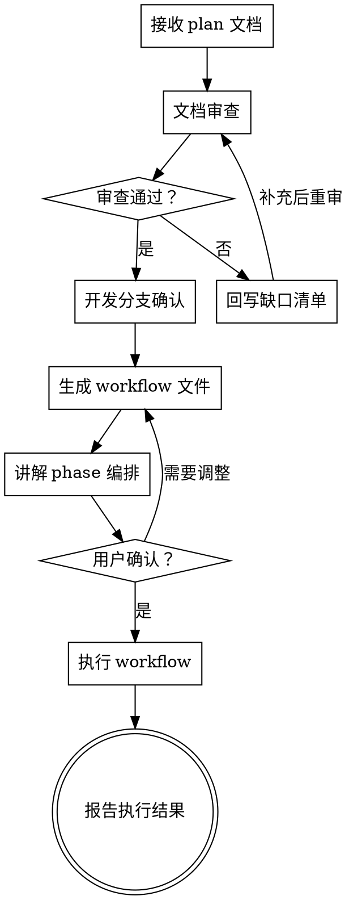

# 用 workflow 执行实现计划

把 `smart-exec-plan` 的流程固化成一份可执行的 workflow 脚本：Stage 严格串行、Task 严格串行，失败测试编写、测试审查、实现、规格与质量并行审查、提交、Stage 审查、全量验证、合并全部由脚本编排。模型只负责判断，不负责决定下一步做什么。

**开始时声明：** “我正在使用 smart-exec-plan-workflow 技能生成并执行 plan 的 workflow。”

## 与 smart-exec-plan 的分工

| 技能 | 适用 |
|---|---|
| `smart-exec-plan` | 手工推进，主代理逐 Task 分派与判断，适合 Stage 少、需要频繁干预 |
| `smart-exec-plan-workflow` | 脚本编排，主代理只在开始时审查计划与确认脚本，之后由 workflow 连续执行 |

本技能复用 smart-exec-plan 的规则（分支命名、Task commit 粒度、Stage amend、`--no-ff` 合并、最终验证），不重新定义。两者不得对同一份计划同时执行。

## 总体流程



## 1. 接收输入

需要从用户处明确：

| 项 | 缺失时 |
|---|---|
| plan 文档路径（一个或多个 Stage 计划） | 停止并询问，不自行猜测计划文件 |
| brainstorming 索引路径 | 询问；确实没有时记录"无索引"，此时跳过执行状态回写 |
| 设计文件路径（每个 Stage） | 询问；没有时以计划与索引为准，脚本中 `designs` 写 `null` |
| 术语表 / CONTEXT 路径 | 询问；没有时脚本中 `context` 留空 |
| 基线分支 | 询问；默认取当前分支 |
| 是否分 Stage 合并回基线分支 | 询问；默认开启 |

先读取全部输入文件，确认 Stage 数量与顺序。计划文件数量与索引不一致时停止，不要自行增删 Stage。

## 2. 文档审查

在生成任何脚本之前，按下表审查计划文档。发现问题时产出缺口清单并回到用户，不要带着缺口生成脚本。

| 检查项 | 不通过的表现 | 处理 |
|---|---|---|
| Stage 完整性 | 索引列出的 Stage 缺计划文件，或顺序不一致 | 停止，要求补齐 |
| 进度清单 | 缺少 `- [ ]` 条目，或条目与正文 Task 不对应 | 列出差异，要求对齐 |
| Task 原子性 | 一个 Task 跨多个无关联模块，或无法形成单个 commit | 列出需要拆分的 Task |
| Task 字段 | 缺文件范围、提交信息、TDD Step | 列出缺失字段 |
| 文件范围 | 同一 Task 修改了未列入范围的文件，或范围包含无关模块 | 标出冲突 |
| 验证命令 | Task 级验证命令不存在或不可运行；全量验证命令缺失 | 要求补充真实命令，不接受虚构命令 |
| 数据安全 | 涉及持久化数据但没有迁移与回滚说明 | 阻塞，要求补充 |
| 兼容层 | 计划包含新旧接口并存、adapter、双读双写、临时 schema、feature flag 分批切换 | 标出，除非设计明确要求长期兼容 |
| 设计一致性 | 计划中的接口、字段、命名与设计文件或术语表冲突 | 列出冲突点 |
| 计划外内容 | 计划实现了索引中明确排除的功能 | 标出 |

审查结论只有三种：通过、有缺口需补充、阻塞。缺口清单要给出文件路径、位置与具体缺什么，不写"计划不够详细"。

文档审查可用 subagent 并行（按 Stage 分工），每个子代理只读分配到的 Stage 文档与相关设计，返回结构化问题清单。

## 3. 开发分支确认

按 smart-exec-plan 的命名规则确定开发分支 `y`，基线分支记为 `x`：

| 计划内容 | 分支名 |
|---|---|
| 新功能 | `feat/<slug>` |
| bug 修复 | `fix/<slug>` |
| 重构 | `refactor/<slug>` |
| 纯文档 | `docs/<slug>` |
| 构建或维护 | `chore/<slug>` |
| 无法可靠分类 | `work/<slug>` |

确认事项，逐条取得用户同意后再继续：

1. 基线分支 `x` 与开发分支名 `y`
2. 同名分支是否已存在（存在时停止，不覆盖、不删除、不重置）
3. 当前工作区状态：是否只包含本需求的文档改动
4. 是否由脚本创建 `y` 并切换，还是用户自行准备
5. Stage 是否合并回 `x`（开启时每 Stage 一次 `--no-ff` 合并）
6. 需求文档是否需要先形成一个文档 commit（`IMPLEMENTATION_BASE_SHA` 从该 commit 之后开始）
7. 是否允许脚本 `git add` / `git commit` / `git switch` / `git merge`（默认允许，但需用户确认）

分支操作使用：

```bash
git switch -c <y>
```

不使用 Git worktree。工作区存在无关改动时停止，不执行 `git stash`、`git reset`、`git clean`。

## 4. 生成 workflow 文件

从 [templates/stage-workflow.js](templates/stage-workflow.js) 复制一份，只替换 `meta` 中的占位符与 `CFG` 配置块，其余流程编排保持原样。写入项目目录 `.claude/workflows/<slug>-stages.js`。

配置项：

| 键 | 说明 |
|---|---|
| `repo` | 仓库绝对路径 |
| `index` | brainstorming 索引路径；没有时留空字符串 |
| `context` | 术语表路径；没有时留空字符串 |
| `fullVerify` | 全量验证命令，来自计划中的真实命令 |
| `devBranch` / `baseBranch` | 开发分支 `y` 与基线分支 `x` |
| `mergeEnabled` | 是否每 Stage `--no-ff` 合并回 `x` |
| `stages` | Stage 编号数组，如 `[1, 2, 3]` |
| `plans` | Stage 编号到计划路径的映射 |
| `designs` | Stage 编号到设计路径的映射，没有设计文件时写 `null` |
| `limits` | 审查轮次、修复 Task 上限，默认 `reviewRounds: 4`（测试审查与实现审查各自适用）、`stageRepairs: 3`、`finalRepairs: 3`（收尾阶段三类修复共享）、`implRetries: 1` |
| `efforts` | 每类调用的 reasoning effort：`phases` 按 phase 给默认值，`calls` 按调用类型覆盖；缺省时继承主 agent。`model` 不配置，始终继承主 agent。默认值见 orchestration-spec 第 9 节 |

生成时的硬性要求：

- 脚本是纯 JavaScript，不带类型注解
- `meta` 必须是纯字面量，不能出现变量、函数调用、展开或模板插值
- `meta.phases` 的标题必须与脚本中 `phase` 字段完全一致
- 仓库约定写进字符串常量（不用 `&&` 串联命令、Python 用 uv、前端用 pnpm、禁止 emoji）
- 所有子代理都经由 `call(kind, ...)` 发起，phase 与 effort 由 `CALL_PHASE` 和 `CFG.efforts` 决定；每个调用都必须带 `schema`（纯文本步骤除外）
- Stage 与 Task 严格串行，只用顺序 `await`；唯一的 `parallel` 是 Review phase 内规格与质量两个只读审查，不使用 `pipeline`

完整格式约束见 [references/orchestration-spec.md](references/orchestration-spec.md)。

## 5. 讲解 phase 编排

生成脚本后向用户说明以下内容，让用户能在执行前判断流程是否符合预期：

- 每个 phase 做什么、由谁判断、失败如何处理
- Stage 与 Task 的串行关系，为什么不能并行（同一工作区，多个实现者会互相覆盖）；Review 内两个审查为什么可以并行（只读，不改工作区）
- 测试编写、测试审查与实现为什么拆成三个代理，`NOT_APPLICABLE` 适用于哪些 Task（这类 Task 跳过测试审查）
- 审查循环：测试审查打回测试编写者；规格与质量并行审查、合并问题清单统一修复、修复后两者都重审；复审附上一轮问题；minor 只记入 concerns；上限与超限后的停止行为
- 每类调用的 effort 配置，哪些项继承主 agent
- Stage 验证只记录、由 Stage 审查归因；最终验证是硬门槛及其修复轮次
- 哪些情况会整体停止（工作区不干净、测试或实现阻塞、缺少红/绿阶段证据、审查超限、最终验证修复超限、合并冲突）
- 哪些步骤会执行 Git 写操作，写操作由哪些 agent 负责
- 全部完成后产出什么报告
- 停止后如何恢复，尤其是 Task 提交前中断留下的未提交改动如何处理

讲解使用表格或阶段清单，按实际脚本内容描述，不要复制模板的通用描述。

## 6. 用户确认后执行

用户确认脚本与 phase 编排后，使用 Workflow 工具执行：

- `scriptPath` 指向生成的 `.claude/workflows/<slug>-stages.js`
- 需要限定 Stage 范围时通过 `args` 传入 `{ stages: [...] }`，模板的 `stageList` 已优先读取 `args.stages`；只跑前几个 Stage 时不会触发最终验证与最终审查
- 不要在确认前执行，也不要在执行时改动脚本内容

执行过程中不插入交互，不并行推进多个 Stage。

## 7. 执行结果上报

workflow 返回结构化报告，包含 `implementationBaseSha`、每个 Stage 的 Task SHA、验证结果、审查结论、合并 SHA 与 `blocked`。上报时：

- 成功完成：列出 Stage、Task 数量、merge commit、最终验证命令与结果
- 中途停止：给出停止的 Stage、Task、原因、已完成范围、工作区状态、`x` 与 `y` 的 SHA
- 汇总各 Task 的 `concerns`（`DONE_WITH_CONCERNS` 说明与未修复的 `[minor]` 意见），供人工后续处理
- 不把"部分完成"表述为成功
- 不自动 push，不删除分支

Stage 已合并到 `x` 后发生中断时不自动 revert；中间 Stage 可能处于暂时不可部署状态，如实说明剩余 Stage。

## 8. 中断恢复

| 中断位置 | 工作区状态 | 处理 |
|---|---|---|
| Task 提交前（TestDesign 到 Review） | 残留该 Task 未提交的测试或实现，重跑时 preflight 会因不干净而停止 | 列出残留文件、所属 Task、已有的红/绿阶段证据，交用户决定：保留并手动完成提交后重跑，或由用户自行丢弃后重跑 |
| Task 已提交、Stage 未完成 | 干净，进度清单已勾选 | 直接重跑，Scout 只会提取未勾选 Task |
| 追加修复 Task 后、修复提交前 | 计划文件与修复改动未提交 | 同“Task 提交前”，计划追加内容一并报告 |
| Stage 状态 amend 或合并阶段 | 视具体步骤 | 先确认 `y`、`x` 的 HEAD 与索引执行状态，再决定从哪个 Stage 重跑 |

脚本未改动时优先用 `resumeFromRunId` 复用已完成调用；脚本改动后必须新开 run。任何情况下都不自动执行 `git stash`、`git reset`、`git clean`、`git restore`。

## 固定编排契约

流程顺序固定，任何项目都不得增删 phase 或调整顺序：

```text
Scout → TestDesign → TestReview → Implement → Review → Commit → StageReview → Verify → Merge
```

| Phase | 负责 | 不负责 |
|---|---|---|
| Scout | 基线检查、Stage 基线 SHA、提取未完成 Task 全文 | 修改文件 |
| TestDesign | 只写会失败的目标测试，确认红阶段原因正确；按测试审查意见修复测试 | 修改生产代码 |
| TestReview | 实现前审查测试是否必要、充分、符合 Task 与设计、红阶段有效 | 修改文件 |
| Implement | 在已有失败测试上实现功能使其转绿，修复审查问题 | 删改测试迎合实现、提交、切换分支 |
| Review | 规格审查（缺失、多余、兼容层、数据风险）与质量审查（正确性、清晰度、测试质量）并行，两者都通过才提交；minor 不阻塞 | 修改文件 |
| Commit | 勾选进度、限定范围 `git add`、提交；Stage 执行状态 amend | 修改实现 |
| StageReview | Stage 整体覆盖、Task 间集成、最终状态方向、Stage 验证失败归因；最终审查 | 修改文件 |
| Verify | 运行计划中的真实验证命令 | 修复、猜测原因 |
| Merge | `--no-ff` 合并、冲突回滚 | 选择冲突内容 |

每个 Stage 内循环：Task 提取 → 写失败测试 → 测试审查 → 实现转绿 → 规格与质量并行审查 → 提交，直至计划中的 Task 全部完成；再执行 Stage 验证、Stage 审查与修复循环；最后一个 Stage 追加最终验证与最终审查；之后状态 amend、合并。

测试与实现拆给两个独立代理：测试编写者不能改生产代码，红阶段因此是工作区里的客观事实，不是实现者的自述；实现者不能删改测试，绿阶段才有意义。正因为实现者不能改测试，测试写偏会直接把实现带偏，所以测试在实现前先经过独立的测试审查，未通过时打回测试编写者修复。纯文档、静态资源等没有测试 Step 的 Task 由测试编写者返回 `NOT_APPLICABLE` 并说明理由，跳过测试审查。

验证分两种：

| 验证 | 时机 | 失败时 |
|---|---|---|
| Stage 验证 | 每个 Stage 的 Task 全部提交后 | 只记录，不停止。结果交给 Stage 审查判断失败属于本 Stage 缺陷（追加修复 Task）还是后续 Stage 承接的中间状态（放行） |
| 最终验证 | 最后一个 Stage 审查通过后 | 硬门槛。失败明细作为修复 Task 追加到最后一个 Stage 计划，修复后先做收尾复审，再重新完整验证；验证通过后才执行最终审查 |

收尾阶段有三类修复来源：最终验证失败、收尾复审 `NEEDS_CHANGES`、最终审查 `NEEDS_CHANGES`。三类修复都追加到最后一个 Stage 计划，走标准 Task 循环，共享 `finalRepairs` 轮次上限。收尾复审时全部 Stage 已完成，不再有“归属后续 Stage”的豁免。每轮修复与复审通过后都回到最终验证重新开始。

这与 workflow README 的验证边界一致：中间 Stage 可以暂时无法构建，最终状态必须全部通过。

## 停止条件

出现以下任一情况立即停止并上报，不自行降级或跳过：

- 工作区不干净，或当前分支不是约定的 `y`
- 测试编写者或实现者返回 BLOCKED / NEEDS_CONTEXT 且补充上下文后仍未解决
- 测试编写者未给出红阶段证据或测试文件，实现者未给出绿阶段证据
- 测试审查在轮次上限内未通过
- 规格与质量审查在轮次上限内未同时通过
- Stage 审查在修复上限内未通过（Stage 验证失败本身不停止，由审查归因）
- 收尾阶段修复（最终验证失败、收尾复审、最终审查）用尽 `finalRepairs` 轮仍未通过
- 合并冲突，或基线分支 HEAD 与预期不一致
- 提交后工作区不干净，或暂存范围包含无关文件

## 禁止事项

- 在文档审查未通过时生成或执行脚本
- 修改模板的 phase 顺序、增删 phase、把 Stage、Task 或实现、提交步骤改成并行
- 在执行中修改脚本并使用相同 runId 掩盖改动
- 让测试编写者、实现者或审查者执行 Git 写操作
- 让测试编写者或测试修复者改生产代码，或让实现者删改测试
- 使用计划中没有的验证命令
- 自动 push、删除分支、覆盖同名分支
- 自动 `git stash`、`git reset`、`git clean`
- 把审查结论、验证失败或阻塞包装成完成
