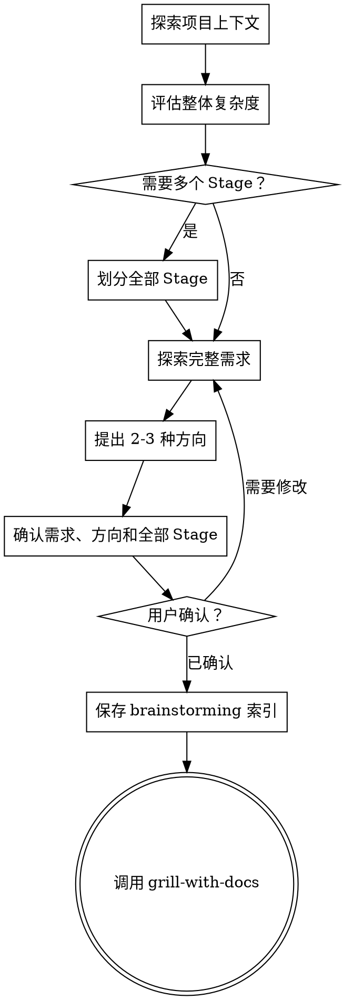

# 将想法转化为完整需求

通过协作讨论，将想法转化为明确的需求边界、方向选型和 Stage 划分。一次 brainstorming 必须覆盖整项需求及全部 Stage；后续不会在 Stage 之间重新讨论需求。

## 一次性最终状态原则

本工作流中的代码修改以全部 Stage 完成后的最终系统为目标，一次性完成设计与实施。Stage、Task 和 Git 检查点只表达设计依赖、执行顺序、局部验证和审查边界，不代表可运行、可部署或可发布的中间状态。除非需求明确要求长期兼容，不为 Stage 或 Task 之间的中间状态增加兼容层、过渡接口或独立部署方案。

**开始时声明：** “我正在使用 brainstorming 技能探索完整需求和方向。”

<HARD-GATE>
在完整需求、方向选型和全部 Stage 获得用户确认前，不得调用 grill-with-docs、writing-plans 或任何实现技能。
</HARD-GATE>

## 何时不使用

- 修复已知 bug：使用 systematic-debugging
- 审查已有代码：使用 code-review
- 用户明确指定不采用本流程：按用户指定方式处理

## 流程



## 过程

## 阶段性保存

每当讨论形成一部分可确认结果时，立即将结果写入 brainstorming 索引或对应文档，不得等全部讨论完成后才首次写入。

至少在以下节点保存：

- 目标和范围形成后
- 成功标准形成后
- 方向选型形成后
- Stage 划分、依赖或顺序形成后
- 用户确认后的版本形成后

文件中区分已确认内容、待决定内容和后续需要补充的内容。


### 1. 探索项目上下文

开始时读取与需求有关的项目结构、入口、实现、测试和文档。只有当需求涉及整体架构或跨模块依赖时，才读取完整项目地图和全部 ADR。

检查：

- 项目结构和主要入口
- 与需求有关的现有实现和测试
- 相关上下文文档
- 与需求有关的 ADR
- 最近提交和当前工作区状态

能通过代码和文档确认的事实不向用户重复询问。

### 2. 评估并划分 Stage

需求包含多个里程碑或规模过大时，划分为多个严格串行的 Stage。划分依据是实现依赖和文档规模，不是中间版本的发布能力；Stage 不要求形成可运行、可部署或可发布的中间版本。

Stage 不表示：

- 可部署版本
- 可运行的中间版本
- 可发布的中间版本
- 需要长期维护的兼容边界
- 需要重新进入 brainstorming 的独立需求

Stage 只用于：

- 控制设计和计划文档规模
- 表达实现先后依赖
- 形成执行时的 Git 合并检查点

无须拆分时，将整项需求视为一个隐式 Stage。

### 3. 探索完整需求

沿设计树自顶向下确认：

- 目标和使用场景
- 做什么与不做什么
- 最终成功标准
- 技术和业务约束
- 全部 Stage 的范围、依赖和顺序

优先使用选择题。每次解决一个上层决策，再讨论依赖它的下层决策。

### 4. 提出方向

提出 2-3 种不同方向，说明：

- 最终结构差异
- 主要权衡
- 与现有代码模式的匹配程度
- 推荐方向及理由

方向选型只决定采用哪种整体方案。接口、错误处理、数据流和测试细节交给 grill-with-docs。

### 5. 确认完整需求

展示并确认：

- 完整需求边界
- 最终成功标准
- 选定方向
- 全部 Stage 的范围
- Stage 间依赖和执行顺序
- 明确排除的内容

确认只发生一次。不得只确认第一个 Stage 后进入设计。

## 重要变更与发布操作

检查数据库结构、已有数据迁移或删除、外部契约不兼容、必需环境配置、部署与外部依赖、服务或运行任务中断、专项公告、旧版本恢复限制。数据库表、字段、约束和索引的实际变化即使自动迁移也须标识；可选配置且默认行为不变、常规构建重启、仅内部调用调整不单独标识。公告独立判断，不能只按技术破坏性判断。不得将未知事项记为“无”。

探索完整需求时评估这些事项，在需求索引一级标题之后、正文之前维护整项需求的引用块，标题固定为“重要变更与发布操作”。有相关事项时记录类别、影响、更新代码之外的操作、执行时机、公告、恢复限制、详细说明链接和评估状态。只记录已知事实，命令级细节交给设计阶段。

尚不明确时写“待确认”并列出具体问题；完成评估且无相关事项时写“已评估，无需额外操作，无不兼容变更，无专项公告”。完整需求确认中包含重要变更及待确认事项。后续设计改变影响范围时同步索引。

开发期间 Stage 的不可用状态不属于发布影响；从已有部署升级到最终系统所需的数据保护和发布操作仍须记录。

## 产出

保存到：

```text
docs/brainstorming/YYYY-MM-DD-<slug>.md
```

slug 使用 kebab-case 英文，并由所有后续文档沿用。

文档至少包含：

```markdown
# <功能名称> 需求与方向

> **重要变更与发布操作：** <填写本节规定的引用块；未完成评估时注明待确认事项>

## 需求边界

## 最终成功标准

## 方向选型

## 明确排除

## Stage 索引

### Stage 1：<名称>

- 范围：<该 Stage 负责的最终能力>
- 依赖：无
- 设计状态：未完成
- 计划状态：未完成
- 执行状态：未完成
- 设计文件：尚未生成
- 计划文件：尚未生成

### Stage 2：<名称>

- 范围：<该 Stage 负责的最终能力>
- 依赖：Stage 1
- 设计状态：未完成
- 计划状态：未完成
- 执行状态：未完成
- 设计文件：尚未生成
- 计划文件：尚未生成
```

无显式 Stage 时仍保留一个 Stage 条目，便于后续 skill 使用统一结构。

## 状态维护

- grill-with-docs 完成一个 Stage 后，更新对应设计状态和设计文件。
- writing-plans 完成一个 Stage 后，更新对应计划状态和计划文件。
- smart-exec-plan 完成并审查一个 Stage 后，更新对应执行状态。
- 状态更新与对应产物或代码一起提交，不生成纯状态提交。

## 终止条件

满足以下条件后调用 grill-with-docs：

1. 完整需求已确认。
2. 最终成功标准已确认。
3. 方向选型已确认。
4. 全部 Stage 的范围、依赖和顺序已确认。
5. brainstorming 索引已保存。

brainstorming 不在 Stage 之间重新启动。
