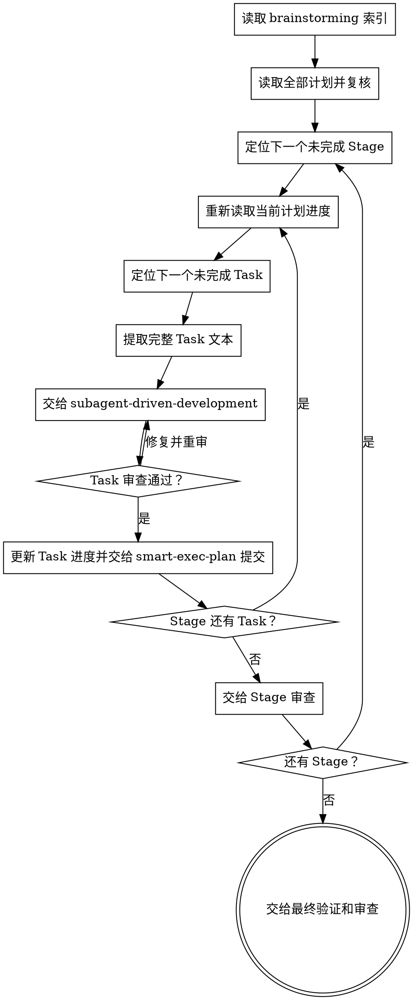

# 解析并推进实现计划

本技能负责计划读取、复核、定位和推进，不管理分支、提交或合并。Git 操作由 smart-exec-plan 统一控制，Task 实现与审查由 subagent-driven-development 执行。

**开始时声明：** “我正在使用 executing-plans 技能解析并推进全部 Stage 计划。”

## 输入

从 brainstorming 索引读取按顺序排列的全部计划文件。每个计划对应一个 Stage。

同时读取：

- brainstorming 需求索引
- 当前 Stage 的设计文件
- CONTEXT 或对应 context 文件
- 当前 Stage 计划
- 前序 Stage 计划和完成状态

## 层级

```text
Stage → Task Group → Task → Step
```

- Stage 严格串行。
- Task Group 严格串行。
- Group 内 Task 当前按计划顺序串行。
- Task 内 Step 严格串行。

Stage 和 Task 都不是独立部署边界。

## 流程



## 开始前复核

开始实现前一次性复核全部计划：

1. brainstorming 索引是否列出全部 Stage 和计划文件。
2. Stage 编号、依赖和文件是否一致。
3. 每个计划是否有完整进度清单。
4. Task 是否包含具体文件、测试、行为和提交信息。
5. 前序 Stage 是否提供后续 Stage 依赖的最终接口。
6. 最后一个 Stage 是否记录真实的完整验证命令。
7. 是否存在仅用于保持中间服务运行的兼容 Task。

关键缺口会导致错误实现时，在创建开发分支和修改代码前停止。不得自行补充设计决策。

## Task 定位规则

每次 Task 循环开始时重新读取当前计划文件，这是上下文压缩后恢复位置的唯一依据。

定位顺序：

1. 找到第一个未完成 Group。
2. 找到该 Group 第一个未完成 Task。
3. 读取该 Task 的完整正文。
4. 读取它引用的设计章节、术语和直接依赖。
5. 将完整 Task 文本交给 subagent-driven-development。

不得只依赖对话中的计划摘要。

## Task 完成条件

Task 只有同时满足以下条件才可标记完成：

1. 计划中的 Step 全部执行。
2. 当前 Task 的红阶段失败已经验证。
3. 当前 Task 的目标测试通过。
4. 规格审查通过。
5. 代码质量审查通过。
6. 没有未解释的计划外修改。

满足条件后：

1. 将进度清单中的 Task 标记为完成。
2. 把计划文件、代码和测试一起交给 smart-exec-plan 提交。
3. 提交成功后进入下一个 Task。

本技能不自行运行 `git commit`。

## 验证边界

Task 完成时只要求计划规定的局部验证通过。不得为了让中间 commit 可部署而增加兼容代码。

以下状态可以留给后续 Task：

- 调用方尚未全部迁移
- 完整构建暂时失败
- 服务暂时无法启动
- 旧接口已经删除而后续模块尚未更新

前提是当前 Task 已完成自身计划职责，且遗留部分明确属于后续已定义 Task。

完整构建、类型检查、lint、单元测试和集成测试在全部 Stage 完成后统一执行。

## Stage 边界

当前 Stage 所有 Task 提交后，交给 subagent-driven-development 执行 Stage 审查。Stage 审查通过后由 smart-exec-plan：

- 更新 brainstorming 中的执行状态
- 将状态更新合入该 Stage 最后一个 Task commit
- 使用 `--no-ff` 合并到原分支
- 切回开发分支继续下一 Stage

本技能不在 Stage 之间暂停，不调用 brainstorming，也不询问是否继续。

## 阻塞处理

立即停止并报告：

- 计划缺少关键接口或验收标准
- 实际代码与设计存在无法自行决定的冲突
- 当前 Task 依赖未定义产物
- 测试无法形成正确的红阶段失败
- 审查问题反复修复仍不通过
- 出现计划外数据损坏风险

回退判断：

- 最终需求范围不清：回到 brainstorming
- 最终接口、数据或错误契约不清：回到 grill-with-docs
- Task 描述不足：回到 writing-plans
- 实现技术问题：在当前 Task 内提供上下文、拆分修复或使用更强模型

阻塞时不得猜测，不得修改已完成 Task 的进度。
