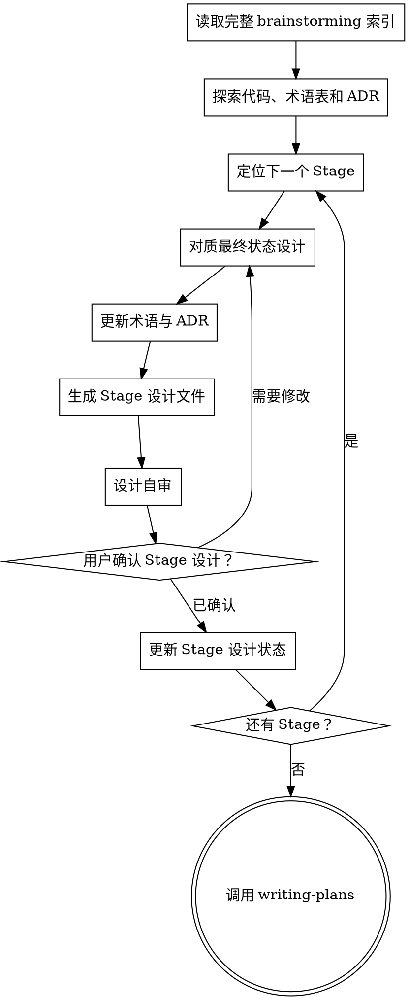

# 领域对质与最终状态设计

读取 brainstorming 确认的完整需求和全部 Stage，按顺序完成每个 Stage 的设计。设计目标是全部 Stage 执行后的最终系统，不为开发期间保持服务运行而增加过渡兼容机制。

**开始时声明：** “我正在使用 grill-with-docs 技能依次完成全部 Stage 的设计。”

<HARD-GATE>
在全部 Stage 的设计分支完成对质、术语和方案细节达成共识前，不得调用 writing-plans 或任何实现技能。
</HARD-GATE>

## 输入

读取 brainstorming 产出的索引文件：

```text
docs/brainstorming/YYYY-MM-DD-<slug>.md
```

必须获得：

- 完整需求边界
- 最终成功标准
- 方向选型
- 明确排除的内容
- 全部 Stage 的范围、依赖和顺序

不得只读取第一个 Stage 后提前交给 writing-plans。

## 输出

每个 Stage 生成独立设计文件：

```text
docs/grill/YYYY-MM-DD-<slug>-stage-1.md
docs/grill/YYYY-MM-DD-<slug>-stage-2.md
docs/grill/YYYY-MM-DD-<slug>-stage-N.md
```

同时按需更新：

- `docs/CONTEXT.md` 或对应 context 文件
- `docs/CONTEXT-MAP.md`
- `docs/adr/NNNN-<decision-slug>.md`
- brainstorming 索引中的设计状态和设计文件

无显式 Stage 时使用统一的 Stage 1 文件名。

## 流程



## 探索既有实现

开始设计前检查：

- `docs/CONTEXT.md` 或 `docs/CONTEXT-MAP.md`
- `docs/adr/`
- 领域模型、接口、数据结构和错误类型
- 各 Stage 会修改的直接调用方
- 现有测试和构建约束

代码是现状事实来源。设计文档描述目标状态，两者冲突时明确记录需要替换的现有行为。

## 最终状态优先

设计每个 Stage 时，只描述它在完整需求完成后承担的职责。除非最终需求明确要求长期兼容，否则不得为了开发期间保持服务运行而加入：

- 新旧接口并存
- compatibility adapter
- deprecated alias
- 双读或双写
- 新旧 Schema 并存
- 临时数据格式转换层
- feature flag 分批切换
- 为旧调用方保留的临时入口
- 为中间 Stage 准备的独立部署方案

Stage 无须独立部署，也无须保证完成该 Stage 后服务可启动。

以下内容仍须设计：

- 最终架构和组件边界
- 最终接口和数据模型
- 最终错误处理
- 全部 Stage 完成后的外部契约
- 数据完整性和不可逆操作保护
- 用户明确要求长期保留的兼容行为
- 最终测试策略

数据安全不等同于开发期间兼容。允许一次性替换旧结构，但不得丢失或错误转换已有数据。

## 逐一对质

对每个 Stage 沿设计树逐项确认：

- **术语精确性**：领域术语是否与 CONTEXT 一致
- **最终职责**：该 Stage 最终负责什么，不负责什么
- **接口边界**：组件完成全部 Stage 后如何交互
- **数据流**：最终数据从哪里产生、流向哪里
- **错误处理**：最终异常如何传播和呈现
- **数据安全**：迁移、删除和不可逆操作是否保护数据
- **测试策略**：当前 Stage 的行为测试及最终集成测试
- **跨 Stage 依赖**：后续 Stage 依赖哪些明确产物

每次只提出一个需要用户决定的问题。能从代码确认的事实不询问用户。

## 术语和 ADR

术语确认后立即更新 CONTEXT。格式参见 [CONTEXT-FORMAT.md](./CONTEXT-FORMAT.md)。

方案决策同时满足以下条件时创建 ADR：

1. 难以逆转。
2. 缺少背景会令人困惑。
3. 存在真实权衡。

格式参见 [ADR-FORMAT.md](./ADR-FORMAT.md)。

不得为纯开发过渡机制创建 ADR，因为这类机制默认不应存在。

## Stage 设计文件结构

每个设计文件至少包含：

```markdown
# <功能名称> Stage N 设计

**需求索引：** `docs/brainstorming/YYYY-MM-DD-<slug>.md`
**Stage：** N / 总 Stage 数
**依赖：** 无或前置 Stage

## Stage 职责

## 最终架构位置

## 接口定义

## 数据流与数据安全

## 错误处理

## 与其他 Stage 的契约

## 测试策略

## 明确排除
```

“明确排除”应记录未采用的开发期兼容机制，防止 writing-plans 再次引入。

## 自审

使用 [spec-document-reviewer-prompt.md](./spec-document-reviewer-prompt.md) 审查：

- 当前 Stage 是否符合完整需求
- 最终状态是否清晰
- 与已确认 Stage 是否一致
- 跨 Stage 契约是否明确
- 是否包含纯过渡兼容设计
- 数据安全是否完整
- 测试策略是否覆盖最终行为

审查通过并获得用户确认后：

1. 更新 brainstorming 索引中的设计状态为已完成。
2. 写入对应设计文件。
3. 继续下一个 Stage。

## 终止条件

仅在以下条件全部满足后调用 writing-plans：

1. 全部 Stage 已完成设计。
2. 全部 Stage 设计已通过自审。
3. 全部 Stage 设计已获得用户确认。
4. CONTEXT 已更新。
5. 符合条件的 ADR 已创建。
6. brainstorming 索引记录了全部设计文件。

交接内容包括 brainstorming 索引和按顺序排列的全部 Stage 设计文件。
