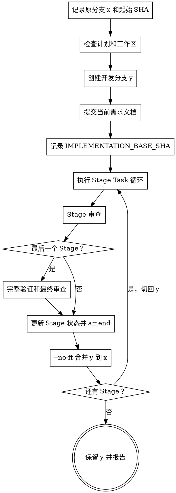

# 智能执行全部 Stage 计划

一次连续执行 brainstorming、grill-with-docs 和 writing-plans 已确认的全部 Stage。设启动分支为 `x`，创建开发分支 `y`；每个 Task 在 `y` 上形成一个 commit，每个 Stage 完成后使用 `--no-ff` 合并到 `x`。

**开始时声明：** “我正在使用 smart-exec-plan 技能连续执行全部 Stage 计划。”

## 必须组合的技能

开始前立即加载并调用：

- `$skill:executing-plans`：[executing-plans](../executing-plans/SKILL.md)
- `$skill:test-driven-development`：[test-driven-development](../test-driven-development/SKILL.md)
- `$skill:subagent-driven-development`：[subagent-driven-development](../subagent-driven-development/SKILL.md)

executing-plans 和 subagent-driven-development 在开始时加载；test-driven-development 在每个 Task 实现前调用。三个调用缺一不可。

职责划分：

- executing-plans：计划复核、Task 定位和进度推进
- test-driven-development：Task 内红—绿—重构
- subagent-driven-development：实现者和多层审查
- smart-exec-plan：分支、提交、Stage 合并和异常保护

不得把三个技能作为互斥选项，也不得重复执行同一计划。

## 输入

必须获得：

- brainstorming 需求索引
- 按顺序排列的全部 Stage 设计文件
- 按顺序排列的全部 Stage 计划文件
- CONTEXT 或对应 context 文件
- 计划引用的 ADR

brainstorming 索引中的全部设计状态和计划状态必须为已完成。任何 Stage 缺少设计或计划时停止。

## 总体流程



## 1. 记录原分支

启动时执行只读检查并记录：

- 当前分支名 `x`
- `X_BASE_SHA`
- 当前 `x` 的预期 HEAD
- 需求 slug
- Stage 数量和顺序
- 全部计划文件

当前处于 detached HEAD 时停止。调用本技能即表示允许从当前分支创建 `y`，并在每个 Stage 后合并回 `x`，包括 `x` 为 main 或 master 的情况。

禁止使用 Git worktree。

## 2. 生成开发分支名

根据计划目标选择类型：

| 内容 | 分支名 |
|---|---|
| 新功能 | `feat/<slug>` |
| bug 修复 | `fix/<slug>` |
| 重构 | `refactor/<slug>` |
| 纯文档 | `docs/<slug>` |
| 构建或维护 | `chore/<slug>` |
| 无法可靠分类 | `work/<slug>` |

分支名必须反映实际开发内容。远端或本地存在同名分支时停止，不自动覆盖、删除、重置或复用。

## 3. 工作区和文档检查

创建 `y` 前读取：

```bash
git status --short
git diff
git diff --cached
```

允许存在的未提交修改只有当前需求的文档：

- brainstorming 索引
- 全部 Stage grill 文件
- 全部 Stage plan 文件
- 当前需求修改的 CONTEXT
- 当前需求创建或修改的 ADR

### 暂存区存在当前需求文档

如果暂存区包含任一 brainstorming、grill 或 plan 文件：

1. 根据 slug、索引引用和设计引用确定完整文档集合。
2. 确认全部相关未提交文档都已暂存。
3. 确认不存在无关暂存、未暂存或未跟踪文件。
4. CONTEXT 或 ADR 同时混有其他需求修改时停止，要求先拆分变更。
5. 保持暂存区不变并创建 `y`。
6. 在 `y` 上把完整文档集合提交为一个 commit。

不得自动把无法确认归属的文件加入暂存区。

文档提交格式：

```text
docs: 固化 <功能名称> 的需求、设计与实现计划

记录完整需求边界、各 Stage 设计、实现计划、领域术语及架构决策。
```

### 暂存区没有当前需求文档

所有相关文档应已提交到 `x`。此时工作区必须干净，创建 `y` 后不生成空文档提交。

### 禁止操作

不得自动执行：

- `git stash`
- `git reset`
- `git clean`
- 覆盖现有分支
- 删除用户文件
- 提交无关修改

## 4. 创建开发分支

检查通过后：

```bash
git switch -c <y>
```

完成可选文档提交后记录当前 HEAD 为 `IMPLEMENTATION_BASE_SHA`。最终代码审查从该 SHA 开始，不把需求文档提交计入实现差异。

## 5. 执行 Task

每个 Stage 开始前记录 `STAGE_BASE_SHA`。每个 Task 按以下顺序执行：

1. executing-plans 重新读取当前计划进度并定位 Task。
2. 记录当前 HEAD 为 `TASK_BASE_SHA`。
3. subagent-driven-development 分派全新实现者。
4. 实现者应用 test-driven-development 修改代码和测试。
5. 规格审查当前工作区相对 `TASK_BASE_SHA` 的差异。
6. 原实现者修复规格问题并重新审查。
7. 规格通过后执行代码质量审查。
8. 原实现者修复质量问题并重新审查。
9. 审查通过后更新计划进度，将当前 Task 标记为完成。
10. 检查暂存范围只包含当前 Task 的代码、测试和计划文件。
11. 使用计划中的提交信息提交。
12. 确认工作区干净，再进入下一个 Task。

一个 Task 只生成一个 commit。实现者和审查者不得提交。

Task commit 必须包含：

- 当前 Task 的生产代码
- 当前 Task 的测试
- 当前 Task 对计划进度的更新
- 审查中完成的修复

不得生成纯进度 commit。提交信息必须符合仓库约定：英文类型、中文标题、中文正文。

## 6. 中间状态

Task 和 Stage 不承担服务连续运行要求。中间 commit 可以暂时无法完整构建、启动或部署，不得因此增加最终不需要的兼容层。

每个 Task 仍须满足：

- 当前 Task 的红阶段失败正确
- 当前 Task 的目标测试通过
- 规格和质量审查通过
- 数据没有丢失或损坏
- 未完成集成明确属于后续计划 Task

不维护中间失败清单，不为中间状态创建恢复 Task。全部 Stage 完成后统一要求完整验证通过。

## 7. Stage 审查和修复 Task

当前 Stage 所有计划 Task 已提交后，使用 stage-reviewer-prompt 审查 `STAGE_BASE_SHA..HEAD`。

返回 NEEDS_CHANGES 时：

1. 在当前 Stage 计划的进度清单和正文中追加具体修复 Task。
2. 修复 Task 必须写明文件、行为、测试和提交信息。
3. 按标准 Task 循环实现和审查。
4. 将计划更新、修复代码和测试提交为一个 commit。
5. 重新执行 Stage 审查，直到 APPROVED。

不得用纯文档 commit 添加修复 Task。

## 8. 最终验证和最终审查

最后一个 Stage 的 Stage 审查通过后、合并前：

1. 从计划读取真实的完整验证命令。
2. 依次运行构建、类型检查、lint、单元测试和集成测试。
3. 项目未配置的项目用代码库证据确认，不运行虚构命令。
4. 任一实际命令失败时创建修复 Task，执行标准 Task 循环。
5. 完整验证通过后执行 final-reviewer-prompt。
6. 最终审查返回 NEEDS_CHANGES 时创建修复 Task。
7. 修复后重新执行 Stage 审查、完整验证和最终审查。
8. 直到最终审查返回 APPROVED。

最终状态不允许保留中间失败、未迁移调用方、旧实现或临时兼容代码。

## 9. 更新 Stage 状态

Stage 审查通过后，在 brainstorming 索引中把当前 Stage 执行状态改为已完成。

该更新不得形成独立 commit。执行：

1. 暂存 brainstorming 索引。
2. 确认只有该 Stage 状态发生变化。
3. 使用 `git commit --amend --no-edit` 合入当前 Stage 最后一个 Task commit。
4. 记录 amend 后新的 `Y_STAGE_HEAD_SHA`。
5. 确认工作区干净。

每个 Stage 必须至少包含一个 Task，因此始终存在可承载状态更新的最后一个 Task commit。

## 10. `--no-ff` 合并到原分支

Stage 状态更新完成后：

1. 记录开发分支 `y` 的 HEAD。
2. 切换到 `x`。
3. 确认 `x` 的 HEAD 等于记录的预期 HEAD。
4. 不一致时停止，不自动整合外部变更。
5. 执行 `git merge --no-ff <y>`。
6. 使用符合仓库规范的合并信息。
7. 记录 merge commit SHA，并更新 `x` 的预期 HEAD。
8. 确认工作区干净。
9. 仍有 Stage 时切回 `y` 继续执行。

合并信息格式：

```text
merge: 完成 <功能名称> Stage N

集成 Stage N 的全部 Task、测试及进度记录。
```

`y` 不需要合并 `x` 上刚产生的 merge commit。后续 Stage 继续在 `y` 的线性历史上提交，下一 Stage 再次使用 `--no-ff` 合并。

## 11. 合并冲突和异常

### 合并冲突

发生冲突时：

1. 执行 `git merge --abort`。
2. 确认 `x` 回到合并前预期 HEAD。
3. 切回 `y`。
4. 保留全部 Task commit。
5. 报告冲突文件和两个分支 SHA。
6. 停止，不自行选择冲突内容。

### Task 阻塞

保留当前未提交修改，不 reset、不 stash。报告：

- 当前 Stage 和 Task
- 已完成 Task
- 阻塞原因
- 工作区状态
- `x` 和 `y` 的 SHA

### 后续 Stage 中断

已经合并到 `x` 的 Stage 不自动 revert。由于中间 Stage 不保证服务可用，`x` 可能处于暂时无法部署状态。准确报告剩余 Stage，不用表面成功掩盖中断。

## 12. 完成状态

全部 Stage 合并后：

- 保留开发分支 `y`
- 不自动 push
- 不删除本地或远端分支
- 确认 `y` 的全部 commit 已包含在 `x` 历史中
- 确认 `x` 工作区干净

最终报告包含：

- 原分支 `x`
- 开发分支 `y`
- `X_BASE_SHA`
- `IMPLEMENTATION_BASE_SHA`
- 每个 Stage 的最终 Task SHA
- 每个 Stage 的 merge commit SHA
- 完整验证命令和结果
- 最终审查状态
