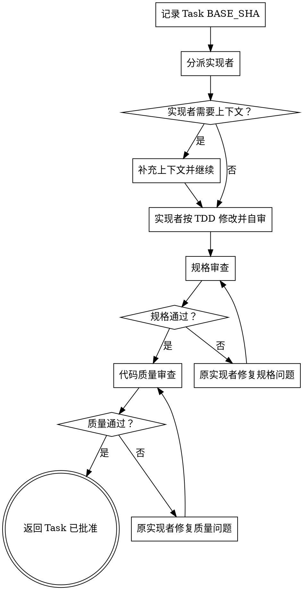

# 子代理驱动开发

每个 Task 使用全新实现者子代理，并依次经过规格审查和代码质量审查。所有 Task 完成后执行 Stage 审查；最后一个 Stage 合并前执行全需求审查。

**开始时声明：** “我正在使用 subagent-driven-development 技能实现并审查计划中的 Task。”

## 职责边界

本技能负责：

- 分派 Task 实现者
- 处理实现者问题和状态
- 规格审查
- 代码质量审查
- Stage 审查
- 全需求最终审查

本技能不负责：

- 创建或切换 Git 分支
- 提交、amend 或合并
- 更新计划和 brainstorming 进度
- 决定 Stage 顺序

这些 Git 和进度操作由 smart-exec-plan 统一控制。

## 核心规则

- 每个 Task 使用全新实现者上下文。
- 实现者不得自行读取整个计划，控制器提供完整 Task 文本。
- 实现者遵循 test-driven-development。
- 实现者不执行 Git 提交和分支操作。
- 先规格审查，后代码质量审查。
- 任一审查发现问题，都由原实现者修复并重新审查。
- Task 之间不暂停询问用户。
- 不并行分派会修改同一工作区的实现者。
- 不为中间服务可用性添加兼容代码。

## 单 Task 流程

## 分派实现者

使用 [implementer-prompt.md](./implementer-prompt.md)，提供：

- Task 完整正文
- 当前 Stage 在完整需求中的位置
- 相关设计章节
- CONTEXT 内容
- 依赖 Task 已产生的公共接口
- 工作目录
- 当前 Task 的允许文件范围

不让实现者自行查找计划范围。实现者可以读取完成 Task 所需的代码和调用方。

## 实现者状态

### DONE

实现和自审完成，进入规格审查。

### DONE_WITH_CONCERNS

先检查顾虑：

- 正确性、范围或数据安全顾虑必须先处理。
- 明确属于后续 Task 的集成状态不阻止当前 Task 审查。
- 单纯缺少中间兼容层不是顾虑。

### NEEDS_CONTEXT

提供缺失的设计、代码或依赖信息后恢复同一实现者。

### BLOCKED

判断原因：

1. 上下文不足：补充上下文。
2. 推理能力不足：使用更强模型。
3. Task 过大：依据既有设计拆成修复 Task，不新增设计。
4. 计划缺口：停止并交回 writing-plans。
5. 设计缺口：停止并交回 grill-with-docs。

不得在没有变化的情况下重复分派。

## 规格审查

使用 [spec-reviewer-prompt.md](./spec-reviewer-prompt.md)。审查当前工作区相对 Task BASE_SHA 的实际变更。

规格审查验证：

- 当前 Task 要求是否全部实现
- 是否有计划外功能
- 是否误解最终设计
- 是否添加纯开发过渡兼容代码
- 当前 Task 遗留内容是否确实属于后续已定义 Task

当前 Task 无法独立部署或服务无法启动不是规格问题。

## 代码质量审查

规格审查通过后使用 [code-quality-reviewer-prompt.md](./code-quality-reviewer-prompt.md)。

审查者读取：

- `git status --short`
- 相对 Task BASE_SHA 的完整差异
- 新增未跟踪文件
- 当前 Task 测试结果

审查通过前不得返回 Task 已批准。

## Stage 审查

当前 Stage 所有 Task 已提交后，使用 [stage-reviewer-prompt.md](./stage-reviewer-prompt.md)。

Stage 审查只验证：

- Stage 设计覆盖
- Task 间接口和数据结构一致性
- 是否遗漏本 Stage 职责
- 是否引入计划外兼容机制
- 是否为后续 Stage 提供约定产物

不要求 Stage 可部署、服务可启动或完整测试通过。

Stage 审查返回 NEEDS_CHANGES 时：

1. 在当前 Stage 计划中追加有明确范围的修复 Task。
2. 修复 Task 进入完整的实现者、规格审查和质量审查循环。
3. smart-exec-plan 将计划更新和修复代码提交为同一个 commit。
4. 重新执行 Stage 审查。

## 最终审查

最后一个 Stage 的 Task 和 Stage 审查完成后，使用 [final-reviewer-prompt.md](./final-reviewer-prompt.md)。

最终审查要求：

- 全部成功标准满足
- 跨 Stage 集成正确
- 最终架构与设计一致
- 旧实现和临时代码已清除
- 完整验证通过
- 服务达到最终可用状态

最终审查发现问题时追加修复 Task，执行完整单 Task 审查后重新进行 Stage 和最终审查。

## SHA 规则

- 每个 Task 开始前记录当前 HEAD，作为 Task BASE_SHA。
- 规格和质量审查针对 BASE_SHA 与当前工作区的差异。
- 每个 Stage 开始前记录 HEAD，作为 STAGE_BASE_SHA。
- 初始文档提交后记录 IMPLEMENTATION_BASE_SHA。
- 最终审查范围为 IMPLEMENTATION_BASE_SHA 到开发分支最终 HEAD。

## 模型选择

- 清晰且仅涉及少量文件的 Task：快速模型。
- 多文件集成和调试 Task：标准模型。
- 设计判断、Stage 审查和最终审查：可用的最强模型。

运行环境不支持模型切换时使用默认模型。

## 红线

不得：

- 让实现者提交或切换分支
- 跳过规格或质量审查
- 在规格审查前进行质量审查
- 用实现者自审替代独立审查
- 带着未修复问题进入下一 Task
- 并行修改共享工作区
- 信任实现者报告而不读实际文件
- 因缺少中间兼容层而要求额外实现
- 在最终完整验证失败时批准合并
