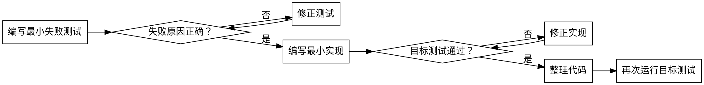

# 测试驱动开发

对有实际行为影响的改动，先建立能区分当前行为与目标行为的最小验证，再编写实现并保持验证通过。验证可以是单元测试、集成测试、命令级检查、渲染检查或其他与产物匹配的可重复检查。

**核心原则：** 验证必须能说明目标行为是否成立，规模与改动影响相称。不要为了满足形式上的红阶段编写没有实际保护作用的测试。

```text
失败测试 → 验证失败原因 → 最小实现 → 目标测试通过 → 整理 → 再次通过
```

## 适用范围

| 场景 | 行为 |
|---|---|
| 新功能 | 为核心行为编写针对性验证；低影响或纯展示改动可采用更轻量的检查 |
| bug 修复 | 优先添加可重现问题的回归测试；已有可靠覆盖时复用它 |
| 行为重构 | 先确认现有行为的有效覆盖，再按需要补充测试 |
| 纯文档和静态资源 | 不构造虚假测试，检查文件内容或渲染结果 |
| 生成文件或机械配置 | 使用与产物相匹配的验证 |

## 验证范围

验证范围应与改动影响相称。目标检查通过后，只有出现新改动、新失败或未解决疑点时，才扩大或重复验证。


## 红—绿—重构



### 先建立有效验证

验证应尽量：

- 只验证一个明确行为
- 名称描述业务结果
- 使用真实代码，除非外部系统使 mock 无法避免
- 包含清晰输入、输出和错误断言
- 在目标行为缺失时失败，或明确证明现有实现已经满足目标

如果验证一开始就通过，先检查它是否真正覆盖目标行为。覆盖成立时记录为已有行为，不修改正确断言来制造失败。因语法、导入或环境错误中止的测试不能证明行为成立。

### 绿：实现目标行为

编写使当前测试通过的最小最终实现：

- 不添加测试未要求的能力
- 不为开发期间保持服务运行而添加兼容层
- 不保留随后会删除的临时接口
- 遵循设计定义的最终命名和结构

### 重构：保持目标测试通过

只在目标测试通过后：

- 移除重复
- 改进命名
- 提取必要辅助函数
- 删除失效代码

整理后再次运行相同测试。

## smart-exec-plan 中的验证边界

smart-exec-plan 连续执行全部 Stage。Task 和 Stage 不是部署边界，因此当前 Task 的绿色状态只要求其计划规定的目标测试通过。

中间 Task 可以存在：

- 尚未迁移的调用方
- 暂时失败的完整构建
- 暂时无法启动的服务
- 将由后续已定义 Task 完成的集成

这不允许当前 Task 忽略自身失败。以下情况仍须立即修正：

- 当前 Task 新增或修改的测试失败
- 失败与后续 Task 无关
- 出现计划外错误
- 数据可能丢失或损坏
- 测试通过依赖虚假断言或过度 mock

全部 Stage 完成后必须运行完整验证，届时不得保留任何中间失败。

## bug 修复

```text
重现 bug 的失败测试
→ 确认测试因该 bug 失败
→ 最小修复
→ 回归测试通过
→ 相关测试通过
```

行为明确且可复现时，优先在生产代码前补回归测试。若测试框架或问题性质不适合，使用最小可重复检查记录复现和修复结果，不为了形式完整而增加测试。

## 测试质量

好的测试应具备：

- **最小**：一个测试只表达一个行为
- **清晰**：名称说明预期结果
- **敏感**：业务规则改变时相关测试会失败
- **真实**：验证真实代码交互，而不是只验证 mock
- **稳定**：不依赖任意等待时间和共享状态

测试是行为规格，不是覆盖率装饰。无法写出准确验证时，先判断是否应改用集成测试、快照、渲染检查或命令级 smoke test；只有目标行为本身无法定义时，才停止并检查设计。

## 禁止做法

- 对需要回归保护的行为先写实现后补测试
- 保留预先写好的实现作为参考再声称采用 TDD
- 验证一开始就通过却未检查其是否真正覆盖目标
- 把导入错误当作正确红阶段
- 为了通过测试修改正确断言
- 只测试 mock 调用次数而不测试行为
- 用宽泛快照代替关键业务断言
- 为中间服务可用性增加最终不需要的兼容代码
- 在最终验证失败时以“中间状态”为理由继续

## Task 完成检查

- 已建立与改动相称的有效验证
- 若采用红阶段，已确认失败原因是目标行为缺失
- 已实现设计规定的最终行为
- 当前 Task 的目标测试通过
- 整理后测试仍通过
- 没有计划外改动
- 没有纯开发过渡兼容代码
